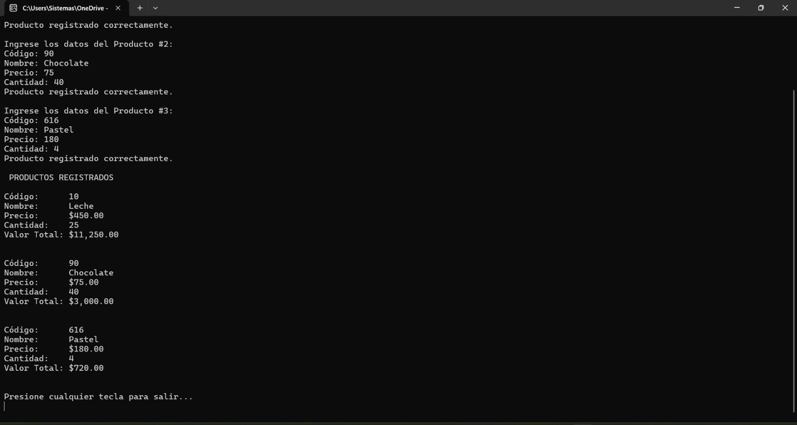

# Actividad-Clases-objetos-y-propiedades

## Descripción del proyecto

Este proyecto consiste en un programa de consola desarrollado en C# para registrar productos de la tienda TecnoPunto. Permite introducir los datos de tres productos y calcular automáticamente el valor total de cada uno según su precio y cantidad disponible.

## Integrantes del equipo

Kenneth Engel Calderón Santana — Matrícula: 2025-3442.

Raudy Esterlin Muñoz — Matrícula: 2024-3943.

Yindri Marielis Ramirez Lifer — Matrícula: 2024-1103.

**Profesor:** Gamalier Reyes del Carmen.

## Datos de entrada

El programa solicita los siguientes datos para cada producto:

- Código.
- Nombre.
- Precio.
- Cantidad disponible.

## Datos que procesa

El programa valida que el nombre no esté vacío, que el precio sea mayor que cero y que la cantidad no sea negativa.

También calcula el valor total de cada producto utilizando la siguiente fórmula:

`ValorTotal = Precio * Cantidad`

Para su funcionamiento utiliza una clase llamada `Producto`, que contiene los campos, propiedades, constructor y método para mostrar la información. También cuenta con un manejo de errores que permite corregir los datos cuando se introducen valores incorrectos.

## Datos de salida

Al finalizar el registro, se muestran los datos de los tres productos, incluyendo código, nombre, precio, cantidad y valor total.

Para probar el programa se utilizaron estos productos:

- Leche: precio 450, cantidad 25. Valor total: 11,250.
- Chocolate: precio 75, cantidad 40. Valor total: 3,000.
- Pastel: precio 180, cantidad 4. Valor total: 720.

## Herramientas utilizadas

- Lenguaje: C#.
- Entorno de desarrollo: Visual Studio.
- Aplicación de consola.

## Objetivo del proyecto

Aplicar los conocimientos de Programación Básica mediante el uso de clases, objetos, propiedades, constructores, métodos, validaciones y manejo de excepciones en C#.

## Imagenes guia del funcionamiento del mismo

.jpeg)

